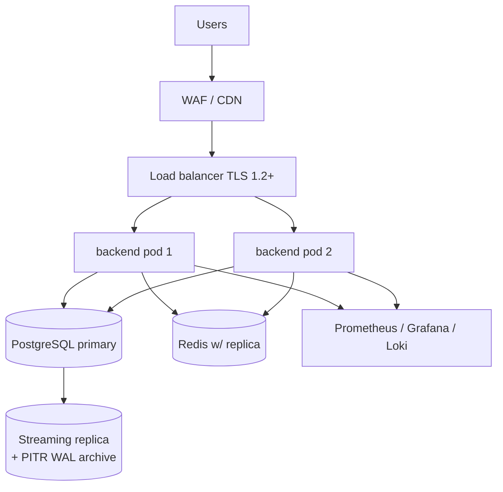

# Khmer Digital Bank — System Architecture

> Status: Phase 1–6 foundation implemented (architecture, design system, schema, auth,
> accounts, ledger-backed transfers). See [Roadmap](#7-implementation-roadmap).

## 1. High-level architecture

```mermaid
flowchart LR
  subgraph Clients
    M[Flutter mobile app<br/>Android / iOS]
    A[Admin web dashboard<br/>(Phase 9)]
  end

  subgraph Edge
    LB[TLS termination / reverse proxy<br/>nginx or cloud LB]
  end

  subgraph Core["Spring Boot modular monolith (backend/)"]
    AUTH[auth]
    USER[user]
    ACC[account]
    LEDGER[ledger]
    TRF[transfer]
    FX[exchangerate]
    QR[qr - Phase 7]
    BILL[billpay - Phase 7]
    TOP[topup - Phase 7]
    CARD[card - Phase 7+]
    NOTI[notification - Phase 8]
    KYC[kyc - Phase 8]
    AUDIT[audit]
    ADMIN[admin - Phase 9]
  end

  PG[(PostgreSQL 16<br/>ledger + domain data)]
  RD[(Redis 7<br/>rate limits, OTP throttling,<br/>idempotency cache)]

  subgraph External["External integrations (interfaces only — require authorization)"]
    SMS[SMS gateway<br/>OTP delivery]
    KHQR[KHQR / Bakong<br/>NBC licensed]
    BILLERS[Billers: EDC, PPWSA, ISPs]
    TELCO[Telco top-up: Smart, Cellcard, Metfone]
    CARDNET[Card processor / network]
    PUSH[FCM / APNs]
  end

  M --> LB --> Core
  A --> LB
  Core --> PG
  Core --> RD
  AUTH -.-> SMS
  QR -.-> KHQR
  BILL -.-> BILLERS
  TOP -.-> TELCO
  CARD -.-> CARDNET
  NOTI -.-> PUSH
```

### Why a modular monolith

One deployable keeps financial operations inside a single ACID database transaction
(debit + credit + fee + audit in one commit). Each module owns its package, its tables and
exposes services only through its `api`/service layer, so it can be extracted into a
microservice later (the ledger and notification modules are the natural first candidates).

## 2. Backend layering (per module)

```
com.khmerbank.<module>
├── api/            REST controllers + request/response DTOs (records)
├── application/    use-case services, transaction boundaries
├── domain/         JPA entities, enums, domain rules
└── infrastructure/ repositories, external gateway adapters
```

Cross-cutting (`com.khmerbank.common`): security (JWT filter, rate limiting), error handling
(RFC 7807 `ProblemDetail`), money type, idempotency, audit.

## 3. Financial integrity rules (enforced in code + database)

| Rule | Implementation |
|---|---|
| No floating point | `BigDecimal` in Java, `NUMERIC(19,4)` in PostgreSQL, decimal **strings** in JSON |
| Double-entry | Every `transactions` row has ≥2 `transaction_entries`; sum(debits) = sum(credits) per currency, verified before commit and by a deferred constraint trigger |
| Atomicity | Single `@Transactional` boundary per financial operation |
| Locking | `SELECT … FOR UPDATE` on `account_balances`, always in ascending account-id order (deadlock-free) |
| Idempotency | `Idempotency-Key` header required on money-moving POSTs; unique `(user_id, idempotency_key)` in `transactions`; replay returns the original result, a different payload with the same key → `409` |
| Immutable ledger | DB triggers reject `UPDATE`/`DELETE` on `transaction_entries` and `audit_logs`; corrections are reversal transactions |
| Reconciliation | `v_ledger_reconciliation` view compares the stored balance with the sum of entries per account |
| Server authority | Balances, fees, FX rates and limits are computed server-side only; the client sends intent, never amounts to credit |
| Authorization | Transaction PIN (BCrypt) verified server-side for every transfer; 5 wrong PINs lock the PIN |

### Cross-currency transfer postings (USD → KHR example)

| Account | Debit | Credit |
|---|---|---|
| Customer A (USD) | 10.00 USD + fee | |
| Fee income (USD) | | fee |
| FX position (USD) | | 10.00 USD |
| FX position (KHR) | 41,000 KHR | |
| Customer B (KHR) | | 41,000 KHR |

Each currency balances independently.

## 4. Security architecture

- **Passwords / PINs / OTPs**: BCrypt (cost 12) for passwords and PINs; OTPs stored as
  SHA-256 HMAC with a server pepper, 5-minute expiry, 5 attempts max.
- **Tokens**: short-lived JWT access token (15 min, HS256 secret from env) + opaque refresh
  token (stored hashed, 30 days) with **rotation and reuse detection**: presenting a used
  refresh token revokes the whole token family.
- **MFA**: login from an unregistered device requires an SMS OTP before tokens are issued.
- **Brute force**: 5 failed logins → account locked 15 minutes; per-IP rate limiting on
  `/auth/**` (Redis token bucket; in-memory fallback in dev).
- **Device management**: `user_devices` with trusted flag; users can revoke devices
  (revokes their refresh tokens).
- **Mobile**: tokens in `flutter_secure_storage` (Keychain / Android Keystore), biometric
  unlock via `local_auth` gates local access only; the server still requires the PIN for
  money movement.
- **Audit**: every auth event and financial operation writes an immutable `audit_logs` row.
- **Masking**: account numbers and phone numbers masked in recipient lookups and logs.

## 5. Flutter architecture

Feature-first clean architecture:

```
lib/
├── main.dart                     entry point → KhmerBankApp
├── app/                          app widget, router (go_router), DI (get_it)
├── core/
│   ├── theme/                    colors, typography, light/dark ThemeData
│   ├── network/                  Dio client, auth interceptor, API exceptions
│   ├── storage/                  secure token storage
│   ├── utils/                    money formatting (decimal strings, no doubles)
│   └── widgets/                  AppButton, AppTextField, BalanceCard, PinInput, …
├── l10n/                         app_en.arb, app_km.arb (gen-l10n)
└── features/<feature>/
    ├── data/                     models (JSON), remote data sources, repository impls
    ├── domain/                   entities, repository contracts, use cases
    └── presentation/             bloc/ (events, states), pages/, widgets/
```

The pre-existing coupon/promotion screens (`lib/coupon`, `lib/coins`, `lib/store`, …) are left
in place untouched and are no longer wired into `main.dart`.

## 6. External integrations requiring authorization

These are defined as Java interfaces with **mock** adapters active only under the `dev`
profile. Mock transactions are flagged `simulated = true` in the database and shown with a
"SIMULATED" badge in the app.

| Integration | Interface | What is required for production |
|---|---|---|
| SMS OTP | `OtpSender` | Contract with a Cambodian SMS aggregator; sender ID registration |
| KHQR / Bakong | `KhqrGateway` (Phase 7) | NBC participant membership, Bakong API credentials, KHQR merchant IDs |
| Interbank transfer | `InterbankGateway` (Phase 7) | Bakong / CSS (Cambodian Shared Switch) membership |
| Billers | `BillerGateway` (Phase 7) | Bilateral agreements with EDC, PPWSA, ISPs etc. |
| Telco top-up | `TopUpGateway` (Phase 7) | Distributor agreements with Smart, Cellcard, Metfone |
| Cards | `CardProcessor` (Phase 7+) | Card issuing processor + scheme (Visa/Mastercard/UnionPay) certification, PCI DSS |
| Push | `PushSender` (Phase 8) | Firebase project (FCM) + APNs key |
| Cash deposit | dev-only `/api/v1/dev/**` | Real deposits come from branch/agent/core-banking integration |

**No claim of KHQR/Bakong compatibility is made** until an authorized integration exists.

## 7. Implementation roadmap

| Phase | Scope | Status |
|---|---|---|
| 1 | Requirements, architecture, ER design, API contract | ✅ this document, `DATABASE.md`, `API.md` |
| 2 | Design system (tokens, themes, reusable widgets), Khmer/English l10n | ✅ foundation |
| 3 | DB schema + migrations, backend foundation, Docker | ✅ |
| 4 | Auth: register, OTP, login + device MFA, refresh rotation, PIN, lockout, devices | ✅ |
| 5 | Accounts: open USD/KHR current & savings accounts, balances, history | ✅ |
| 6 | Ledger + transfers: internal / by phone / by account no., fees, FX, limits, idempotency, receipts | ✅ |
| 7 | QR payments, bill payments, top-up, cards (gateway interfaces + mocks) | ⏳ next |
| 8 | Notifications (WebSocket + push), profile, KYC upload & review | ⏳ |
| 9 | Admin dashboard (web) | ⏳ |
| 10 | Security hardening, full test matrix, performance | ⏳ (core tests present) |
| 11 | CI/CD, staging/prod deployment, monitoring, backups | ⏳ (CI + compose present) |

## 8. Deployment topology (target)



Environments: `dev` (docker compose, mocks on), `staging` (real infra, sandbox partner
credentials), `prod` (secrets from a vault; mocks impossible to enable — the `dev` profile
is rejected at startup when `APP_ENV=prod`).
