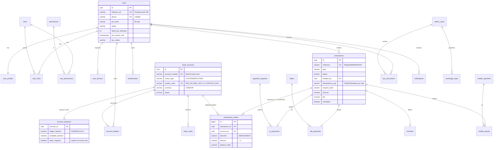

# Khmer Digital Bank — Database Design

PostgreSQL 16. Schema is owned by Flyway migrations in
[`backend/src/main/resources/db/migration`](../backend/src/main/resources/db/migration):

| Migration | Contents |
|---|---|
| `V1__init_schema.sql` | All tables, constraints, indexes, sequences |
| `V2__ledger_guards.sql` | Append-only triggers, double-entry balance trigger, currency trigger, reconciliation views |
| `V3__reference_data.sql` | Roles/permissions, system ledger accounts, USD/KHR rate, limits, fees, billers, telcos |
| `V4__firebase_auth.sql` | Auth moves to Firebase: `users.firebase_uid`, drops password/lockout columns, `refresh_tokens`, `otp_challenges` |

## ER diagram (core banking)



## Accounting model

* **Sign convention:** for every account, `balance = Σ credits − Σ debits`. Customer deposits are
  liabilities of the bank, so a credit increases what the customer sees.
* **System accounts** (`owner_type = SYSTEM`) represent the bank's side: fee income, FX position per
  currency, and — in dev only — *simulated cash*. They may go negative.
* **Invariant:** the sum of all balances in each currency is always `0`
  (`v_ledger_trial_balance`). Any non-zero row means a bug or tampering.
* **Reconciliation:** `v_ledger_reconciliation.difference` must be `0` for every account. Run it
  nightly and alert on any non-zero row.
* **Corrections** are new `REVERSAL` transactions referencing `reversal_of`; entries are never
  updated or deleted (enforced by trigger, including `TRUNCATE`).

## Concurrency & idempotency

1. `pg_advisory_xact_lock(initiator)` serializes money movements started by the same user, so the
   idempotency lookup and daily-limit sum cannot race.
2. Each affected `account_balances` row is locked `FOR UPDATE` in ascending account-id order (no
   deadlocks between transfers in opposite directions), with a 5 s lock timeout.
3. The deferred constraint trigger re-checks that each transaction balances per currency at commit.
4. `UNIQUE (initiated_by, idempotency_key)` is the last line of defence against duplicates.

## Operational queries

```sql
-- accounts out of balance (must return 0 rows)
SELECT * FROM v_ledger_reconciliation WHERE difference <> 0;

-- trial balance (net must be 0 per currency)
SELECT * FROM v_ledger_trial_balance;

-- all simulated money (must be 0 rows in production)
SELECT count(*) FROM transactions WHERE simulated;
```
